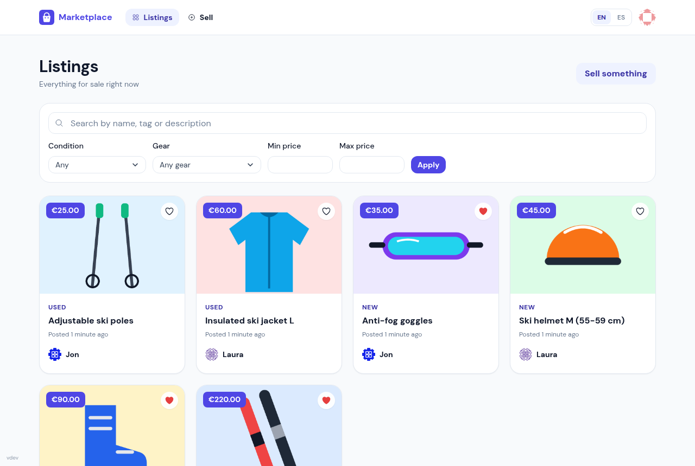
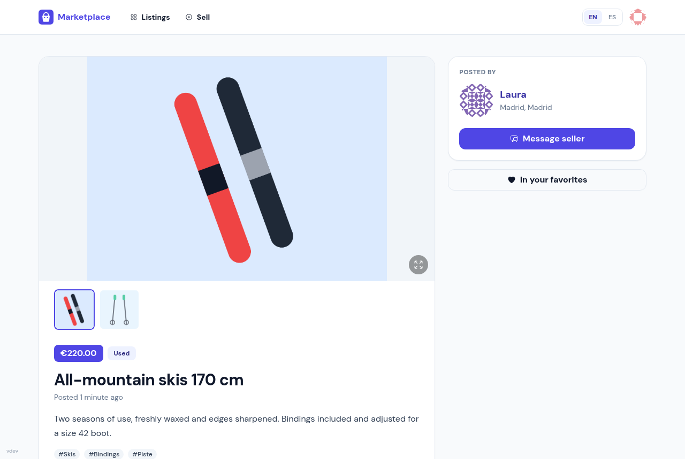
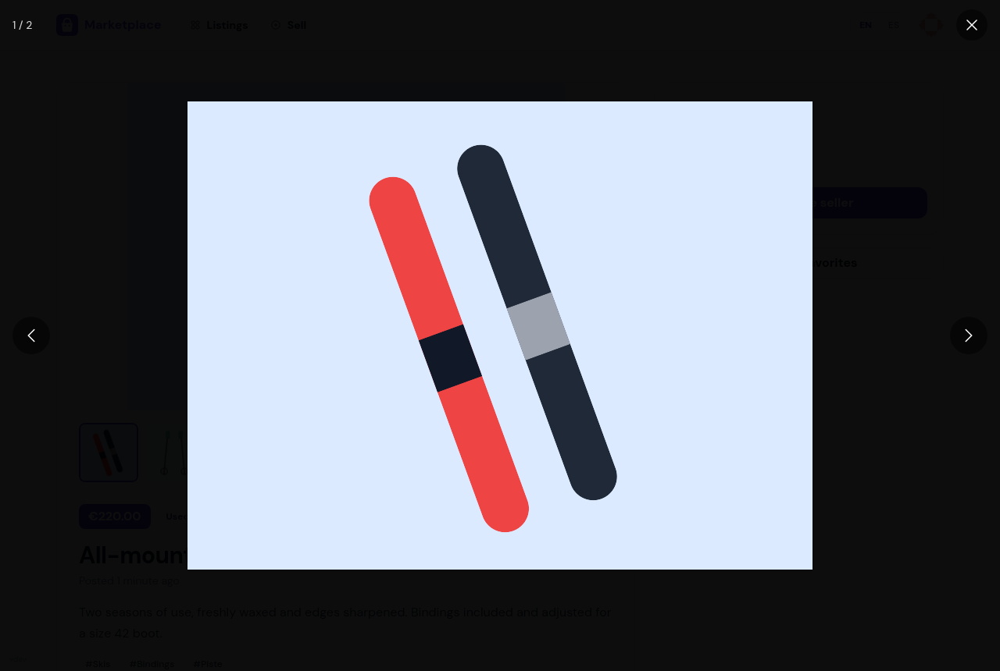
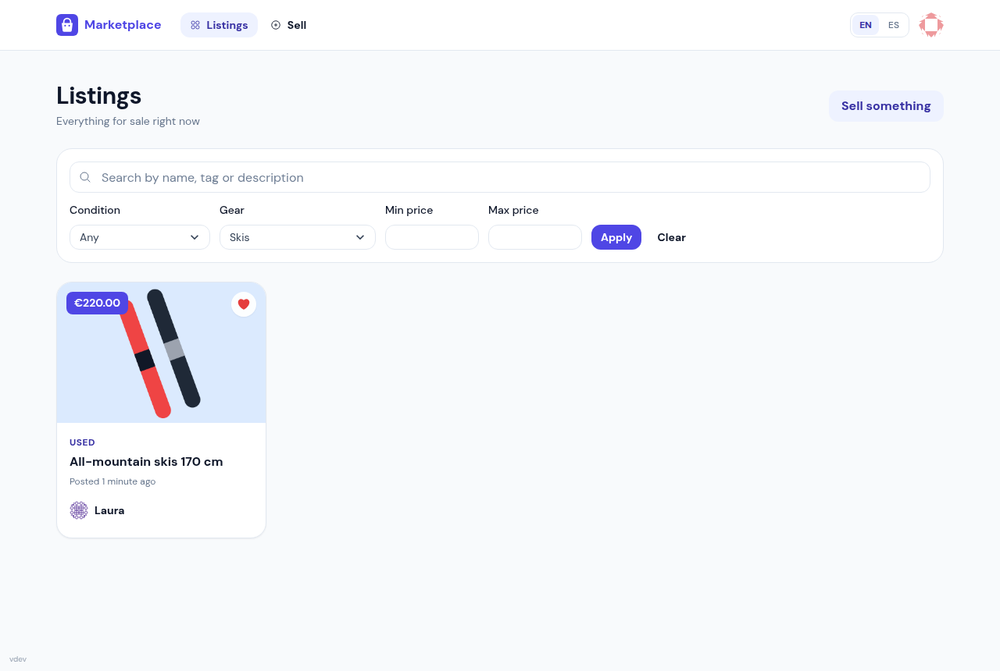
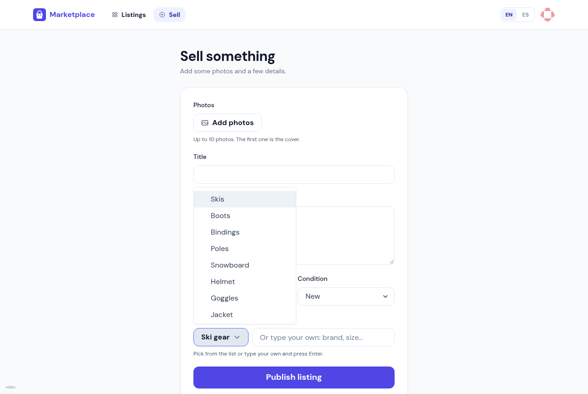
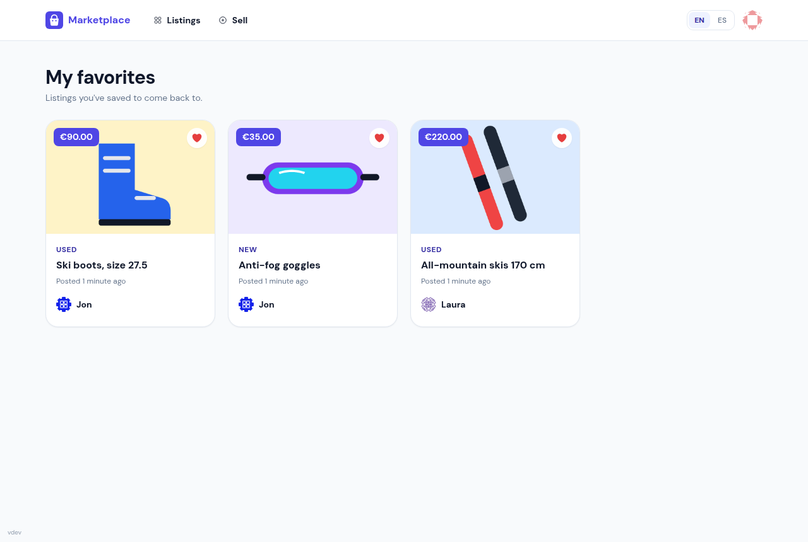
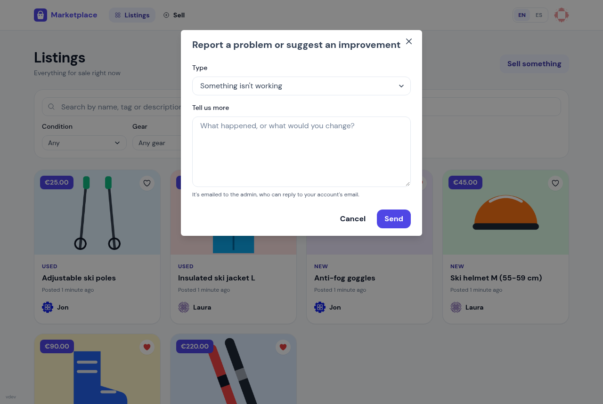
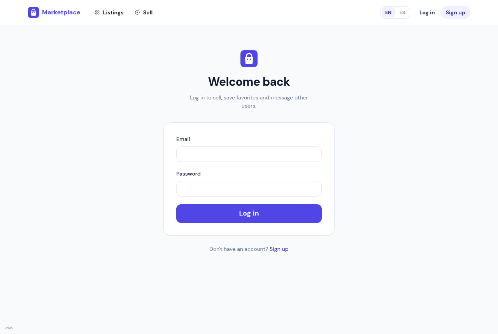
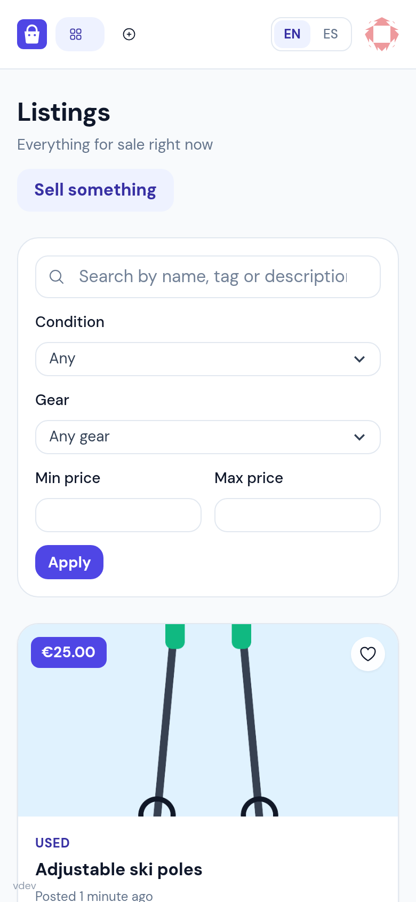

# Marketplace

A second-hand marketplace for buying and selling gear: a React single-page app on top of a Flask JSON API, with PostgreSQL for storage. It's set up for ski equipment out of the box (the tag list is easy to change).

> **Credits:** this project started as a fork of [palu3492/marketplace-web-app](https://github.com/palu3492/marketplace-web-app), a Flask marketplace demo. Many thanks to its author for the original app, which this one grew from.
>
> Thanks as well to [Claude Code](https://claude.com/claude-code) by Anthropic, which made it possible to rework and extend the original code into this app in just a few days.

**Features**

- Listings with up to 10 photos, a full-screen image viewer (arrows, swipe, double-click zoom)
- Fuzzy search over title, tags and description (PostgreSQL `pg_trgm` + `unaccent`), plus filters by condition, gear tag and price
- Predefined gear tags from a dropdown, plus free-text tags
- Favorites, stored per user, with their own page
- Messages between buyers and sellers, with email notifications
- Registration with an optional invite key; everyone else waits for admin approval by email
- Google sign-in, profile pictures
- "Report a problem or idea" form that emails the admin
- English and Spanish UI; the build date is shown as the version in the corner

## Screenshots

| Listings | Listing detail |
|---|---|
|  |  |

| Full-screen photos | Filter by gear |
|---|---|
|  |  |

| Sell something (gear tags) | Favorites |
|---|---|
|  |  |

| Report a problem | Log in | Mobile |
|---|---|---|
|  |  |  |

## Configuration you need to fill in

Nothing personal is committed: every account, email and cloud identifier comes from configuration. Before running or deploying, fill in the following.

### App (`.env` locally, `/opt/marketplace/app.env` on the server)

Copy `.env.example` to `.env`. The ones that matter:

| Variable | What it is | If left empty |
|---|---|---|
| `SECRET_KEY`, `JWT_SECRET_KEY` | Random secrets (`openssl rand -hex 32`) | Insecure development defaults |
| `MAIL_USERNAME`, `MAIL_PASSWORD` | Gmail account the app sends mail from, and its [app password](https://support.google.com/accounts/answer/185833) | No email is sent at all |
| `NOREPLY_MAIL_USERNAME`, `NOREPLY_MAIL_PASSWORD` | Optional separate sender for mail users receive | User mail comes from `MAIL_USERNAME` |
| `REGISTRATION_KEY` | Invite key: people who register with it are approved straight away | Every new user needs approval |
| `REGISTRATION_APPROVER_EMAIL` | Who receives the "approve this user" links | Nobody is notified of pending users |
| `REGISTRATION_CONTACT_EMAIL` | Contact shown to users waiting for approval | The approver's address, or none |
| `FEEDBACK_EMAIL` | Who receives "Report a problem or idea" messages | The approver; with neither set, the form answers 503 |
| `FRONTEND_URL`, `CORS_ORIGINS` | Where the React app is served (links in emails) and which origins may call the API | `http://localhost:5173` for CORS |
| `GOOGLE_OAUTH_CLIENT_ID` | Google sign-in client id | Google sign-in disabled |
| `SENTRY_DSN`, `GCHAT_WEBHOOK` | Error reporting / chat alerts | Disabled |
| `DATABASE_URL` or `POSTGRES_*` | PostgreSQL connection | Local `marketplace` database |

The server's `app.env` is created with these keys empty the first time the VM boots (see `terraform/modules/marketplace-vm/templates/startup.sh.tftpl`); edit it and run `sudo docker compose up -d`.

### Infrastructure (Terraform/Terragrunt on GCP)

| Where | What |
|---|---|
| `GOOGLE_CREDENTIALS_FILE` (env var) | Path to the service-account key JSON used by Terragrunt |
| `GOOGLE_PROJECT` (env var) | GCP project id; the state bucket is `<project>-marketplace-tfstate` |
| `terraform/live/{dev,prod}/terragrunt.hcl` | `domain` and `letsencrypt_email` for HTTPS (both empty = HTTP only); regions and machine sizes |

See [terraform/README.md](terraform/README.md).

### CI/CD (GitHub Actions)

`.github/workflows/deploy.yml` builds both images, pushes them to Artifact Registry and redeploys the VM. In the repository settings:

| Setting | What |
|---|---|
| Secret `GCP_SA_KEY` | Service-account key JSON that can push to Artifact Registry and SSH to the VM through IAP |
| Variable `GCP_PROJECT` | GCP project id |
| Environments `dev`, `prod` | Add required reviewers to `prod` to gate production deploys |

Pushes to `master` deploy to dev; prod is deployed with *Actions → Deploy → Run workflow*. The manual runbook is in [docs/deployment.md](docs/deployment.md).

## Architecture

- **`frontend/`**: React 18 + TypeScript + Vite + Chakra UI + TanStack Query, served by nginx. See [frontend/README.md](frontend/README.md).
- **`app/`**: Flask app factory (`app.create_app`), configured per environment (`development` / `testing` / `production`) through `APP_ENV`.
  - `app/routes/operations`: the JSON API under `/api/v1/...`, JWT-protected and documented (Swagger UI at `/api/v1/docs/ui`).
  - `app/routes/views`: the original server-rendered Jinja pages. **Deprecated**: they still work but every response carries a `Deprecation` header pointing at the React route that replaces it. Don't add features there.
- **PostgreSQL** is required (search relies on `pg_trgm` and `unaccent`). Redis is configured but not used yet.
- **Production**: one VM per environment with Postgres on the host and Docker Compose for the app, the frontend and Redis, behind nginx.

## Local development

```bash
cp .env.example .env                                   # fill in what you need, see above
docker compose -f docker-compose.local.yml up -d db redis
python -m venv venv && source venv/bin/activate
pip install -r requirements-dev.txt
flask --app 'app.__init__alembic:create_app' db upgrade
flask run --port 4000

# in another terminal
cd frontend && cp .env.example .env && npm install && npm run dev   # http://localhost:5173
```

`docker compose -f docker-compose.local.yml up -d` also builds and serves the frontend on `:5173`; rebuild it with `--build` after frontend changes.

### Tests and checks

```bash
pytest -q                     # needs the Postgres from docker-compose.local.yml (creates marketplace_test)
cd frontend
npm run lint && npm run format:check && npm run build
```

CI runs the same checks on every pull request, against the result of merging it into `master`.
